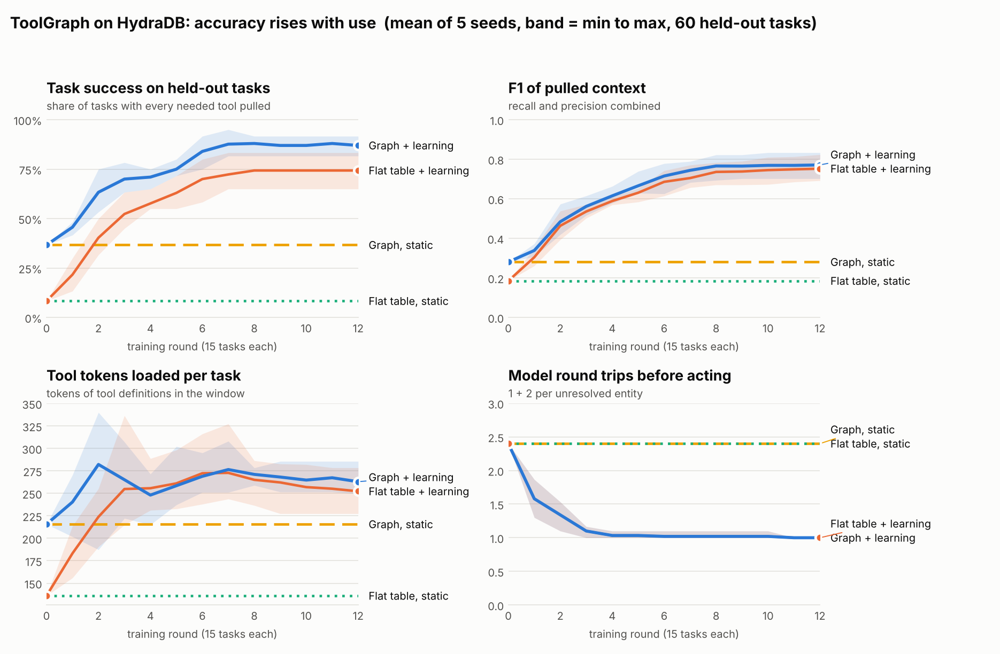

# ToolGraph: a self-improving context layer for agents, on HydraDB

**Track 2 (agent context layer), with a Track 1-style learning loop on top.**

An agent shouldn't carry every tool in its prompt, and it shouldn't learn the same lesson twice.
ToolGraph keeps an agent's **skills, MCP tool definitions, tool dependencies and already-resolved
entities** in a HydraDB graph. For each task the agent makes **one context pull**: the graph is
walked from the task's words and only the needed subgraph is loaded. After the task, the agent
reports which tools it really used and **the graph rewrites itself**.

HydraDB (the open-source engine, `github.com/hydra-db/hydradb`, self-hosted) is the only data store.

```
(:Kw)-[:TRIGGERS {hit,miss}]->(:Skill)-[:USES {hit,miss}]->(:Tool)-[:NEEDS*1..3]->(:Tool)
(:Entity)-[:RESOLVED_BY]->(:Tool)
```

## What the graph does that a lookup table can't

| Mechanism | Where it lives in HydraDB |
|---|---|
| Multi-hop dependencies: `send_email -> find_contact -> search_accounts` is pulled in one traversal | `[:NEEDS*1..3]` variable-length path |
| Edge reweighting: tools that are pulled but never used get pruned, tools that are needed come back | `hit`/`miss` counters stored **on the edges**; an edge is active when `hit/(hit+miss) >= 0.5` |
| Gap-driven learning: a task that matched nothing teaches the graph its words | new `(:Kw)-[:TRIGGERS]->(:Skill)` edges, on probation until confirmed twice |
| Entity memory: once "Acme" is resolved, resolver tools drop out of the window | `(:Entity)-[:RESOLVED_BY]->(:Tool)` |

## Results

**Setup.** 13 task intents, 78 hand-written phrasings. Half are training phrasings, half are
**held-out test phrasings** the graph never sees (they reuse vocabulary but not wording). Each round the
system serves 15 training tasks, gets feedback, and is then scored on the 60 held-out test tasks.
5 seeds, 12 rounds each (180 training tasks). Learning never touches test tasks.

**Baselines (all run in the same experiment):**
- *Graph, static*: the same HydraDB graph, never updated (this is iteration 0).
- *Flat table, static*: a plain keyword -> tool table with no dependency edges.
- *Flat table + learning*: the plain table given the **same feedback rule**. This is the fair learner.



| Held-out metric (mean of 5 seeds) | Graph + learning | Flat table + learning | Flat table, static |
|---|---|---|---|
| **Task success** (every needed tool pulled), round 0 -> 12 | **37% -> 87%** (82-92%) | 8% -> 74% (65-83%) | 8% |
| Rounds to reach 70% success | **3** | 6 | never |
| Recall | 37% -> 89% | 20% -> 82% | 20% |
| Precision | 23% -> 72% | 19% -> 72% | 19% |
| F1 | 28% -> 77% | 19% -> 75% | 19% |
| Model round trips before acting | 2.4 -> **1.0** | 2.4 -> 1.0 | 2.4 |
| Tool tokens loaded | 216 -> 263 | 136 -> 252 | 136 |

Reading it honestly:
- **The graph is doing real work before any learning happens.** At round 0 the static graph already
  succeeds on 37% of tasks versus 8% for the flat table, purely because dependencies come along via
  `NEEDS` traversal.
- **Learning is real and repeatable**: success rises on every seed (82-92% at the end).
- **The graph learns faster and ends higher on success** (87% vs 74%) because a dependency or trigger is
  learned once and applies everywhere. The flat table has to relearn it per keyword.
- **F1 is nearly tied** (77% vs 75%). The graph's edge is recall (finishing the task), not precision.
- Tool tokens go *up* with learning: the system starts out under-fetching and learns to pull the tools that
  were missing. That is the correct direction, not a regression.
- Versus preloading: the catalog is 28,146 tokens; a pull is about 1.2-1.5k tokens including skill
  instructions (about 260 of that is tool definitions).

### Load and scale

16 concurrent threads, 2,400 context pulls each run, one HydraDB node, client and server on one 2-vCPU VM.

| Catalog | Preload cost | Pulls/s | Cypher queries/s | p50 | p95 | p99 | Errors |
|---|---|---|---|---|---|---|---|
| 261 tools | 28,146 tokens | 398 | 2,662 | 38 ms | 65 ms | 77 ms | 0 |
| 2,205 tools | 238,098 tokens | 357 | 2,392 | 42 ms | 72 ms | 86 ms | 0 |

The catalog grew 8.4x; pull size (1,516 tokens for the same task) and latency barely moved, while
preloading would have grown 8.4x to a size that doesn't fit most context windows. The HydraDB node used
about 72 MB of memory.

## Caveats (please read before judging the numbers)

- **Synthetic benchmark.** The intents, phrasings, tool catalog and ground truth are hand-written by the
  authors. No LLM is in the loop, so this measures the context layer, not end-task success. Test phrasings
  share vocabulary with training ones, as real users' words do, but this is still not production traffic.
- **Feedback is an oracle in the experiment.** The learner is told which tools were needed and which skill
  was followed. A real agent would report the tools it ended up calling. Wrong feedback would degrade learning.
- **Precision tops out around 72%.** Edge weights are per skill, so the graph can't tell that
  `log_activity` is needed only when the user says "log". Per-keyword tool weights would help and are not built.
- **No hyperparameter search.** Threshold 0.5, prior 2 hits, probation of 1 hit / 2 misses were set up front.
  One change was made after a smoke test: feedback now carries the skill the agent followed, because
  inferring it from tool overlap tied (`send_email` belongs to two skills).
- Round trips assume 2 model turns to resolve an unresolved entity, identically for every system.
- The 216 "vendor" tools per scale unit are filler standing in for an enterprise long tail.

## Run it

```bash
# HydraDB node (build instructions at the bottom), then:
HYDRADB_DIR=/path/to/hydradb ./run_node.sh &        # local node on :8443
python3 server.py --port 8080                       # seeds a fresh graph, serves the UI
python3 experiment.py --seeds 5 --rounds 12         # regenerate results/curve.json (about 2 min)
python3 plot.py                                     # results/curve.png
python3 loadtest.py                                 # results/load.json
```

Or in one container: `docker build -t toolgraph . && docker run -p 8080:8080 toolgraph`
(builds HydraDB from source, 10-15 min; see the caveat below about this Dockerfile).

The page lets you: type a task and see the exact path walked in HydraDB; send feedback and watch the same
task change; press **Simulate agent use** to watch the curve rise live on the running graph.

Files: `toolgraph.py` (HydraDB client, schema, pull, learn) / `experiment.py` (benchmark + baselines) /
`server.py` + `static/index.html` (demo) / `plot.py` / `loadtest.py` / `Dockerfile`, `start.sh`, `run_node.sh`.

## Who pays for this

**Buyer:** teams running agents against many MCP servers. Every integration adds thousands of tokens to
every call, tool-choice accuracy drops as lists bloat, and every discovery step is a paid model round trip.

**Product:** a hosted context layer for agents. One registry of tools, skills and resolved entities shared
by every agent in an org, with per-task pulls (here about 95% fewer tokens than preloading), permissions as
graph edges (which agent may see which tool), an audit trail of which tools each task used, and entity memory
that makes the second task cheaper than the first. It sharpens with use, so switching away means losing what
the graph learned about your workflows.

**Why HydraDB:** object-store-native storage keeps a large registry cheap and durable; the traversal
(`NEEDS*1..3`) and edge-property updates are what a flat store can't do cheaply; snapshot reads mean an agent
never sees a half-updated catalog.

**Next:** per-keyword tool weights (precision), MCP server front-end so any agent can call `pull_context`,
permission edges, learning from real agent traces.

## HydraDB notes (things we hit)

- Edges with properties must be created one `CREATE` at a time. The batch `UNWIND ... CREATE` form rejects properties.
- `MERGE ... SET` works only inside the `UNWIND` form. Whole-graph wipes must be by label (`MATCH (n:Tool) DETACH DELETE n`).
- The node aborts on its first query unless `RUST_MIN_STACK=33554432` is set.
- In our sandbox only Rust 1.97 was available, so we built with `--ignore-rust-version`; the repo pins 1.99.0. LAGraph
  isn't packaged for Ubuntu and the helper script's tarball download was blocked, so we built `v1.0.2` from a git clone
  with the same cmake flags. **The Dockerfile uses the pinned toolchain but has not been built in the sandbox (no Docker
  daemon there); the container entrypoint (`start.sh`) was tested locally against the binary we built.**
